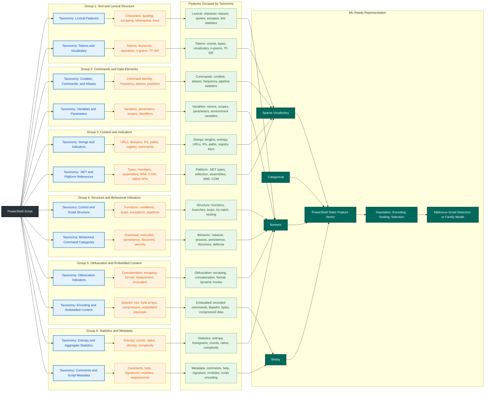

# **`PS2Features`** | PowerShell Feature Extraction Framework for Malware Detection

    
    &nbsp;
    
    &nbsp;
    
    

## Extraction Framework

| Extracted Feature | [Parser Class](https://learn.microsoft.com/en-us/dotnet/api/system.management.automation.language.parser) | [PSScriptAnalyzer](https://learn.microsoft.com/en-us/powershell/utility-modules/psscriptanalyzer/overview?view=ps-modules) | [PSParser Class](https://learn.microsoft.com/en-us/dotnet/api/system.management.automation.psparser) | [tree-sitter-powershell](https://github.com/airbus-cert/tree-sitter-powershell) | [Semgrep](https://semgrep.dev/) | [Joern](https://joern.io/) | [Regex](https://developer.mozilla.org/en-US/docs/Web/JavaScript/Guide/Regular_expressions) |
|---|:---:|:---:|:---:|:---:|:---:|:---:|:---:|
| String and Literal Extraction | ✅ | ⚠️ | ✅ | ✅ | ✅ | ⚠️ | ✅ |
| Comment Extraction | ✅ | ⚠️ | ✅ | ✅ | ✅ | ⚠️ | ✅ |
| Token Extraction | ✅ | ✅ | ✅ | ✅ | ⚠️ | ⚠️ | ⚠️ |
| Variable Extraction | ✅ | ✅ | ⚠️ | ✅ | ✅ | ⚠️ | ⚠️ |
| Function Extraction | ✅ | ✅ | ⚠️ | ✅ | ✅ | ⚠️ | ⚠️ |
| Parameter Extraction | ✅ | ✅ | ⚠️ | ✅ | ✅ | ⚠️ | ⚠️ |
| Cmdlet and Command Extraction | ✅ | ✅ | ✅ | ✅ | ✅ | ⚠️ | ⚠️ |
| Alias Extraction and Resolution | ⚠️ | ✅ | ⚠️ | ⚠️ | ⚠️ | ❌ | ⚠️ |
| Module and Dependency Extraction | ✅ | ✅ | ⚠️ | ✅ | ✅ | ⚠️ | ⚠️ |
| .NET API Call Extraction | ✅ | ⚠️ | ⚠️ | ✅ | ✅ | ⚠️ | ⚠️ |
| Native Executable Call Extraction | ✅ | ⚠️ | ✅ | ✅ | ✅ | ⚠️ | ⚠️ |
| WMI and CIM Call Extraction | ✅ | ⚠️ | ⚠️ | ✅ | ✅ | ⚠️ | ✅ |
| Registry Operation Extraction | ✅ | ⚠️ | ⚠️ | ✅ | ✅ | ⚠️ | ✅ |
| File-System Operation Extraction | ✅ | ⚠️ | ⚠️ | ✅ | ✅ | ⚠️ | ✅ |
| Network Operation Extraction | ✅ | ⚠️ | ⚠️ | ✅ | ✅ | ⚠️ | ✅ |
| Process-Creation Extraction | ✅ | ⚠️ | ⚠️ | ✅ | ✅ | ⚠️ | ✅ |
| Scheduled-Task and Service Extraction | ✅ | ⚠️ | ⚠️ | ✅ | ✅ | ⚠️ | ✅ |
| Encoded Command Detection | ⚠️ | ⚠️ | ⚠️ | ⚠️ | ✅ | ⚠️ | ✅ |
| Obfuscation Indicator Extraction | ⚠️ | ⚠️ | ⚠️ | ⚠️ | ✅ | ⚠️ | ✅ |
| Dynamic Execution Detection | ✅ | ✅ | ⚠️ | ✅ | ✅ | ⚠️ | ✅ |
| Download-and-Execute Pattern Detection | ⚠️ | ⚠️ | ⚠️ | ⚠️ | ✅ | ⚠️ | ✅ |
